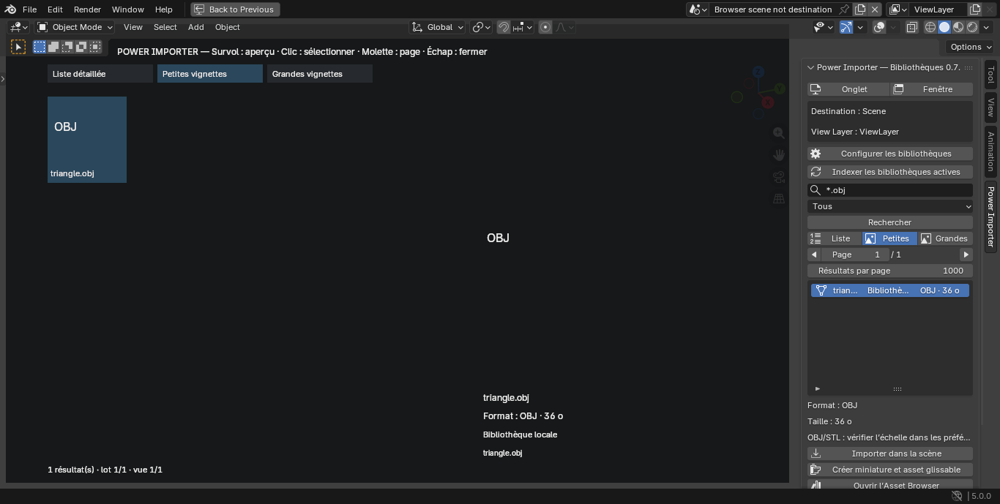
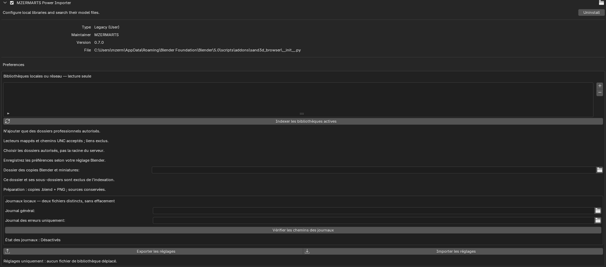
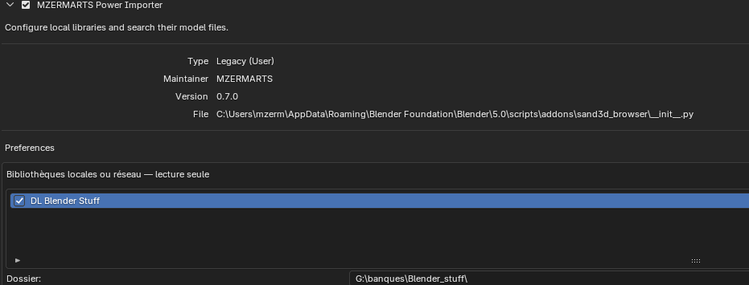
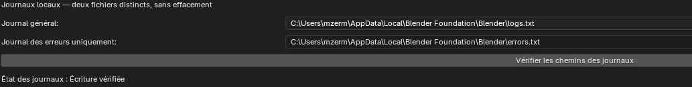

# POWER IMPORTER for Blender

**One browser for your existing asset libraries, across formats, folders and drives.**

POWER IMPORTER is an independent MZERMARTS Blender add-on for finding, previewing and importing 3D models and images from local and network libraries. It brings these tasks together in Blender’s sidebar, a dedicated workspace tab or an independent Blender window.

Current pre-release: **v0.7.0**, tested with **Blender 5.0.0 on Windows**. User validation of this milestone is in progress. Compatibility with Blender 4.2 and 5.2 remains to be validated.

## How the project started

The idea grew out of the availability of [Sand3D’s asset collections](https://github.com/Sandflow-ai/sand3d). Our initial goal was to make these resources easier to browse, organize and use within our own production workflow.

We then expanded the idea to address a broader need: working with Sand3D collections alongside our own extensive asset libraries, accumulated over years of creation across different applications, file formats, local drives and network folders.

Rather than moving or renaming those libraries, we wanted one consistent interface to discover and reuse their contents. POWER IMPORTER evolved from a Sand3D-oriented browser into a general-purpose tool for asset discovery and scene preparation.

Sand3D inspired the starting point. POWER IMPORTER is an independent project, with no implied affiliation or endorsement. Automated downloading or synchronization of Sand3D collections is **not implemented** in 0.7.

## Available in 0.7

- Configure multiple local folders, mapped drives or UNC paths, with meaningful display names, individual activation and optional subfolder indexing.
- Search by words or wildcard patterns such as `*.obj`, `room*` and `*rock*`, and filter results by format.
- Browse a detailed list, small thumbnails or large thumbnails, with enlarged previews and pagination from 50 to 10,000 results per page.
- Generate thumbnails and reusable Blender assets for supported models in a separate Blender process.
- Import supported models into the current scene, or an explicitly defined destination when using the dedicated browser.
- Choose replacement textures manually, or continue without native textures when they are missing.
- Use images to create a material, apply a texture to the active mesh, add a texture to a copy of its material, create an image plane or open an image editor.
- Export/import library mappings and output/log paths as JSON settings.
- Configure separate general and error logs.

Library display names are labels in the add-on: changing them does not rename source folders. Indexing is manual, and source files remain unchanged.

## Downloads and screenshots

- [Installable Blender add-on 0.7.0](releases/sand3d_browser-0.7.0.zip)
- [Windows settings utility](tools/MZERMARTS-PowerImporter-Reglages.exe)
- [Release archive and companion files](DOWNLOADS.md)
- [Screenshots and captions](docs/SCREENSHOTS.md)

### Independent browser window

Isolated integration-test view: the browser displays a different scene while its explicit destination remains the working scene.

### Preferences and network libraries

### Separate operation and error logs

The French screenshots show example workstation paths; adapt them to your own environment.

## Installation and first use

1. Save your current work. If upgrading, export your existing add-on settings first.
2. Install `sand3d_browser-0.7.0.zip` through Blender Preferences > Add-ons > Install from Disk, then enable **MZERMARTS Power Importer**.
3. Open the 3D View sidebar with **N**, then select **Power Importer**.
4. Configure the library folders you are authorized to access and run indexing.
5. Search, select a file and choose the appropriate operation.

The package retains the technical module name `sand3d_browser` for upgrade compatibility. Avoid installing duplicate copies under different names. No additional Python packages are required in the tested Blender installation.

## Sidebar, workspace or independent window

The sidebar remains available. **Onglet** opens or reuses a Power Importer workspace; **Fenêtre** opens an independent main Blender window with an enlarged browser view. These use Blender’s existing editors rather than introducing a new native editor type.

The source window, scene and View Layer are remembered when opening the browser from the working scene. The **Destination** label identifies where imports and active-mesh image operations will take effect. Browsing another scene in the browser window does not silently redirect an import.

If the destination window is closed, or its scene or View Layer changes, the operation is rejected before mutation. Return to the intended Layout and use **Utiliser cette scène comme destination** to bind it again. Destination bindings are session-specific and are not included in settings backups.

Search, filters, selection and index are shared in the session. One gallery is active at a time; Escape closes it, and the list/thumbnail buttons reopen it. Opening the browser does not start indexing or import files.

## Formats and limits

| Content | Current support |
|---|---|
| USD / USDA / USDC | Import and asset preparation |
| OBJ + MTL | Import and asset preparation; material and texture recovery where supported |
| STL | Import and asset preparation |
| GLB / glTF | Import and asset preparation |
| BLEND | Append supported standalone files into a collection |
| PNG, JPEG, BMP, TGA, TIFF, WebP, EXR, HDR | Image actions and previews, subject to Blender decoding |
| 3MF, FBX, DAE | File inventory only in this version |

BLEND files compressed with Zstandard, files requiring a newer Blender version, and files containing linked BLEND libraries are currently rejected. Use a compatible, standalone, uncompressed copy while keeping the original. Embedded scripts are not executed; complex imported drivers and OSL script nodes are muted. Complex animation and rig configurations are not comprehensively certified.

Image previews are available directly; 3D model previews require preparation. Drag-and-drop uses Blender’s native Asset Browser after preparation, not the custom gallery cards. Workbench thumbnails do not reproduce every material or shader.

OBJ/STL units and scale must be checked. Existing UVs are preserved by image operations; an image alone does not define a UV set, and no automatic unwrapping is performed. Batch conversion and general export presets are **not yet implemented**.

## Prepared assets, settings and logs

Choose an existing output folder for prepared BLEND copies and PNG thumbnails. It may be a subfolder of a source library: its entire subtree is excluded from indexing. It must not equal or contain a library root. Changing it invalidates the index; reindex afterwards.

Preparation is currently one asset at a time. A complete cached result is reused. Source files, intermediate files and diagnostics are retained; no automatic cleanup is performed. Links and junctions are not followed by the indexer.

JSON settings backups store library labels, paths, activation, recursion, OBJ/STL scales, prepared-output folder and both log paths. They contain no assets or log contents. Restoring settings does not start indexing or probe every library path. The separate settings script and Windows utility complement the in-add-on controls.

The general and error logs use UTF-8 JSON lines, appended without truncation. They may contain asset paths. Choose storage appropriate to your own data and access requirements.

## Companion Windows utility: settings backup and team deployment

**Back up or restore POWER IMPORTER settings without opening Blender’s interface.** The separate `MZERMARTS-PowerImporter-Reglages.exe` provides file dialogs for selecting the installed Blender executable, exporting a JSON backup or importing an existing configuration. No separate Python installation is needed.

The utility runs the selected Blender installation **in the background**; it is not independent of Blender and requires it to be installed. It reads saved settings and can restore them before the next interactive Blender session. Close Blender after saving your work and preferences first: the utility refuses an operation while Blender is running.

A major use case is **moving a configuration to another workstation or distributing a team-managed library setup**. A team leader can define shared library locations, labels and indexing options, export one JSON configuration and distribute it through the team’s chosen channel. Each user imports it for the appropriate installed Blender version, checks workstation-specific paths, then indexes manually when ready.

POWER IMPORTER supports local folders, **mapped network drives and UNC shares**. Paths are preserved exactly, not automatically translated: `G:\StudioAssets` must point to the intended storage on every machine, while `\\asset-server\StudioAssets` requires the same reachable share and appropriate access rights. Importing settings neither maps a drive nor grants access to a server. Prepared-output and log paths also need review on the receiving machine.

The backup contains settings, not assets, downloaded libraries, thumbnails, logs or the catalogue index. It does not copy a library or synchronize users automatically. **Merge** combines library entries; **replace** replaces this add-on’s configuration. Both modes restore output/log paths from the imported JSON.

See [SETTINGS_UTILITY.md](SETTINGS_UTILITY.md) for the complete backup, migration and team workflow.

## Roadmap and development history

The project has evolved through small, testable milestones. Earlier local builds and their completed features are recorded in [CHANGELOG.md](CHANGELOG.md). The rationale, delivered milestones and planned work toward 1.0 are tracked in [ROADMAP.md](ROADMAP.md).

The 1.0 goal is a reusable preparation workflow: multi-selection, saved asset sets, batch previews/imports and conversion presets that can normalize mixed source formats into a chosen output format. Files should remain individually reusable unless the user explicitly chooses a grouped output.

## Repository layout and working branches

`main` is the shared, reviewable baseline. `addon/0.7` is the add-on development branch; `tools/settings-utility` is the companion utility development branch. Both start from the same prepared baseline and can evolve independently. These are Git branches, not separate copies of the project directories.

- `sand3d_browser/`: add-on Python sources.
- `tools/`: Windows utility executable, C# source and standalone settings helper.
- `tests/`: isolated integration tests and runners.
- `releases/`: preserved installation/source ZIP archives.
- `docs/images/`: screenshots supplied by the maintainer.
- `docs/history/`: preparatory documents kept as historical records; their version-specific statements may be superseded by this README.

## Validation and contributions

Development tests use locally generated fixtures and isolated Blender profiles. The 0.7 GUI tests cover workspace creation/reuse, separate-window operation, imports into the source scene despite a different browser scene, image actions on the target mesh, and rejection after destination change or closure. Existing format, texture-recovery, pagination and settings tests also pass. A browser test screenshot has been inspected visually.

These checks do not certify every asset library, shader, rig or Blender version. Reproducible bug reports should identify the Blender/add-on version, operation, expected result and actual result. Share a minimal fixture or sanitized diagnostic when possible, without private paths or assets you cannot redistribute.

The source archive includes test scripts and a README describing their use. Generated assets, test profiles, user settings and logs are excluded from that archive. The add-on and settings utility do not publish files or contact GitHub automatically.

## License and asset rights

See [LICENSE](LICENSE) for the repository license selected by the maintainer. Imported assets and third-party applications or add-ons retain their own licenses and usage conditions. This repository does not grant rights to redistribute external asset libraries.
