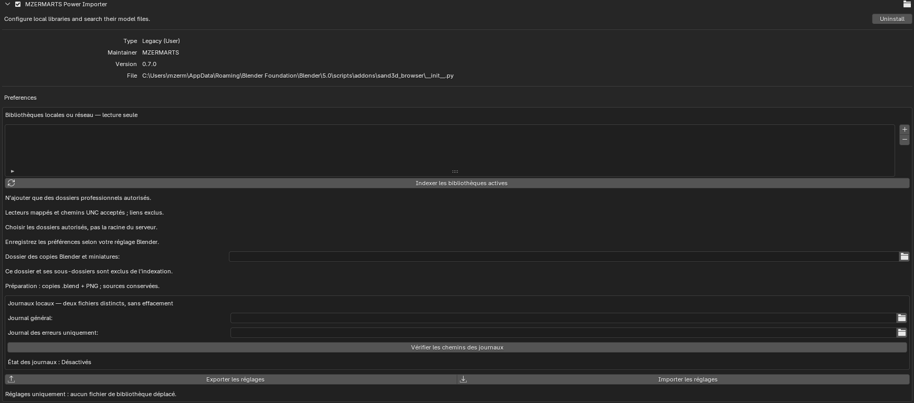
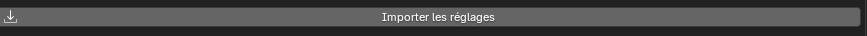
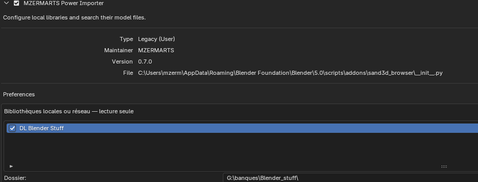
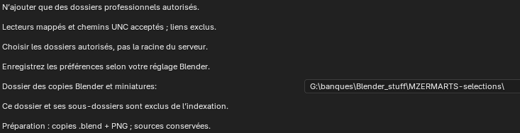
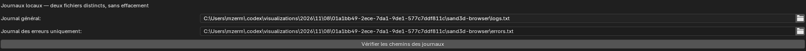
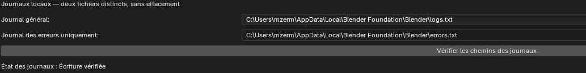

# Screenshots — POWER IMPORTER 0.7

Maintainer-supplied screenshots. French UI labels reflect the current interface. The paths shown are workstation examples, not paths to copy automatically into another machine’s configuration.

## Preferences and library configuration

## Prepared output directory

## Log destinations

The supplied image numbered 006 was empty and has not been included. The original was retained in the preparation folder outside this repository.
